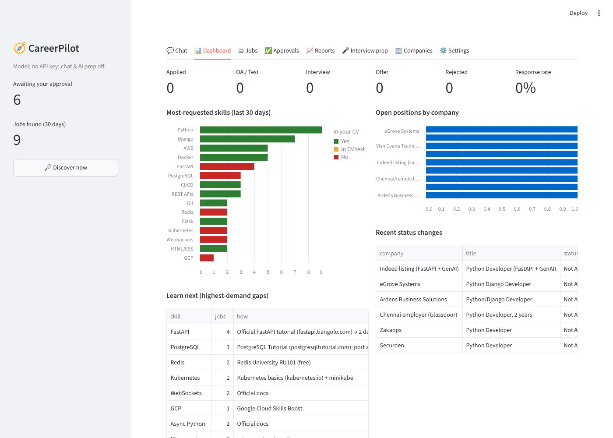
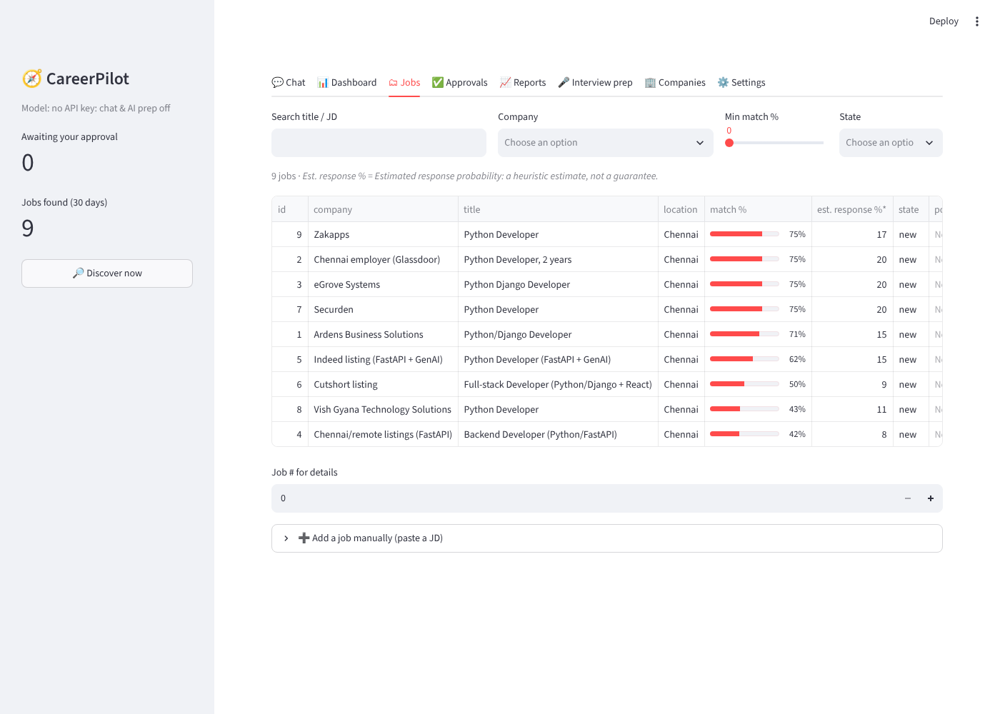

# 🧭 CareerPilot

**An AI-powered job search and application assistant built on Claude.**

You give it your shortlist of target companies (from Notion) and your CV. It then:

- 🔎 **Finds openings** at those companies every day.
- 📊 **Scores each job** against your skills and preferences.
- ✅ **Queues good matches** for your approval.
- 📝 **Pre-fills applications** while you stay in control.
- 📬 **Tracks every status change** by reading your inbox.
- 🔔 **Notifies you** on Gmail and WhatsApp.
- 📈 **Builds Excel and Power BI reports** on the job market and your pipeline.
- 🎤 **Prepares you for interviews** at each company.

You can drive all of it from a **chat interface**.

> Inspired by [career-ops](https://github.com/career-ops-hq/career-ops). Built so it can later plug into a bigger personal assistant ("Jarvis") as a module; see [Jarvis integration](#-jarvis--claude-desktop-integration-mcp).



---

## 📑 Contents
1. [What it does](#-what-it-does)
2. [How it works](#-how-it-works)
3. [Setup (15 min)](#-setup-15-minutes)
4. [Daily use](#-daily-use)
5. [The web app](#-the-web-app)
6. [Applying: the review-and-approve flow](#-applying-the-review-and-approve-flow)
7. [Reports (Excel & Power BI)](#-reports-excel--power-bi)
8. [Notifications (Gmail & WhatsApp)](#-notifications-gmail--whatsapp)
9. [Status tracking from your inbox](#-status-tracking-from-your-inbox)
10. [Interview preparation](#-interview-preparation)
11. [Notion sync](#-notion-sync)
12. [Job sources & companies.yml](#-job-sources--companiesyml)
13. [Scheduling (run it every day)](#-scheduling-run-it-every-day)
14. [Jarvis / Claude Desktop integration (MCP)](#-jarvis--claude-desktop-integration-mcp)
15. [Privacy & security](#-privacy--security)
16. [All commands](#-all-commands)
17. [Limitations (read this)](#-limitations-read-this)
18. [Troubleshooting](#-troubleshooting)
19. [JD toolkit (skills report, recruiter messages)](#-jd-toolkit)

---

## ✨ What it does

| Requirement | How CareerPilot does it |
|---|---|
| **1. Chatbot UI** | A web app with a Claude-powered chat. It can search jobs, explain companies, salaries, skills and your pipeline, generate interview prep, and change your preferences. It also has a dashboard, jobs list, approvals, reports, prep, companies and settings tabs. |
| **2. Market reports** | An Excel workbook with charts for daily, weekly, monthly, all-time or custom date ranges. Sheets: top skills, companies hiring with positions, salary, years asked and locations, roles × technologies, per-job match %, estimated response %, skill gaps with a learning path, applications, funnel, conversion rates, rejection trends, and daily discovery. It also writes **Power BI** star-schema CSVs. |
| **3. Discovery, applying, tracking** | Discovery uses the official public careers APIs (Workday, Greenhouse, Lever, SmartRecruiters, Ashby, Amazon), Adzuna, and your LinkedIn/Naukri alert emails. Then it does **dedupe → score → queue → you approve → pre-fill → you submit**. Statuses come from your Gmail inbox, history is kept in SQLite, and everything syncs to Notion. |
| **4. Notifications** | Gmail (HTML email) and WhatsApp (Twilio or CallMeBot), for new matching jobs and for status changes. Each one includes the company, title, JD excerpt, link, required skills, match %, status, next step and interview date. |
| **5. Interview prep** | A company- and role-specific pack: the company's hiring process, topics mapped to the JD, 10 mock technical Q&As drawn from your CV, 12 named coding problems by pattern, system design, behavioural STAR answers, weak areas with a 7-day plan, and questions to ask. |
| **6. Sensitive info** | CTC, notice period, declarations, consent, e-signatures, passwords, IDs and demographic fields are **never filled and never stored**. Every application needs your approval, an audit log records every action, and the app runs locally only, with an optional password. |

---

## 🏗 How it works

```
 Notion "Job Tracker" ──pull──►  companies.yml (47 companies + tiers + job source)
                                         │
     Workday / Greenhouse / Lever /      ▼
     SmartRecruiters / Ashby / Amazon ─► DISCOVER ─► dedupe ─► SCORE (skills, years, location,
     Adzuna API / job-alert emails                              salary, tier → match % + est. response %)
                                                                     │
                                       below threshold ◄─────────────┤
                                                                     ▼
                         notify (Gmail / WhatsApp) ◄──────── APPROVAL QUEUE  ──► you: ✅ / ❌
                                                                     │ approved
                                                                     ▼
                         you press Submit ◄────── ASSIST: browser opens form, fills safe fields,
                                                  attaches resume, lists 🔒 sensitive fields for you
                                                                     │
   Gmail inbox ──► "received / test / interview / rejected / offer" ─► STATUS TRACKING ─► notify, Notion push
                                                                     │
                                                         SQLite ─► Excel + Power BI reports, chat, dashboard
```

Code layout:

```
careerpilot/
  config.py      settings.yml + .env           db.py         SQLite schema, dedupe, status history
  companies.py   companies.yml + aliases       notion.py     Notion pull/push (never reads passwords)
  sources/       one adapter per job source    discover.py   discover → score → queue → notify
  evaluate.py    match %, est. response %      apply.py      approval queue + browser assist + guards
  inbox.py       Gmail status detection        notify.py     Gmail + WhatsApp
  reports.py     Excel + Power BI              prep.py       interview prep (Claude)
  assistant.py   chat agent (Claude + tools)   api.py        tool API (chat, MCP, Jarvis)
  mcp_server.py  MCP server                    cli.py        command line
app/streamlit_app.py   web app
jhb/                   JD toolkit (skills extraction, recruiter messages); see docs/JD-TOOLKIT.md
tests/                 38 tests incl. a real-browser test of the apply guardrails
```

---

## 🚀 Setup (15 minutes)

### 1. Install
```bash
git clone https://github.com/Sriraam070/CAREER_PILOT.git
cd CAREER_PILOT
python -m venv .venv && source .venv/bin/activate      # Windows: .venv\Scripts\activate
pip install -r requirements.txt
python -m playwright install chromium                  # for assisted applying
```

### 2. Your files (all git-ignored, they never leave your computer)
```bash
cp settings.example.yml settings.yml       # profile + preferences + automation switches
cp companies.example.yml companies.yml     # your 47 Notion companies, already mapped to job sources
cp cv.example.md cv.md                     # paste your CV as Markdown, keep a "## Technical Skills" heading
cp .env.example .env                       # API keys (step 3)
# put your resume PDF in the project folder as resume.pdf
python -m careerpilot init
```
In **`settings.yml`**, set your name, email, phone, links, `years_experience`, and job keywords. Only non-sensitive fields go here: **don't** put CTC or notice period anywhere.

### 3. Keys in `.env` (each one optional; add what you need)

| Feature | Key(s) | Where to get it |
|---|---|---|
| Chat, AI interview prep | `ANTHROPIC_API_KEY` | [console.anthropic.com](https://console.anthropic.com) → API keys |
| Jobs from companies without a public API (TCS, Infosys, Zoho…) | `ADZUNA_APP_ID`, `ADZUNA_APP_KEY` | [developer.adzuna.com](https://developer.adzuna.com) (free) |
| Gmail notifications + inbox status tracking | `GMAIL_ADDRESS`, `GMAIL_APP_PASSWORD` | Google Account → Security → 2-Step Verification → **App passwords** → create "CareerPilot" |
| WhatsApp (option A, reliable) | `TWILIO_ACCOUNT_SID`, `TWILIO_AUTH_TOKEN`, `TWILIO_WHATSAPP_FROM`, `WHATSAPP_TO` | [twilio.com](https://www.twilio.com) → Messaging → WhatsApp sandbox (send the join code from your phone first) |
| WhatsApp (option B, free, personal) | `CALLMEBOT_APIKEY`, `WHATSAPP_TO` | [callmebot.com WhatsApp API](https://www.callmebot.com/blog/free-api-whatsapp-messages/) |
| Notion sync | `NOTION_TOKEN`, `NOTION_DATABASE_ID` | See [Notion sync](#-notion-sync). The database ID is already filled in. |
| Web app password | `CAREERPILOT_APP_PASSWORD` | Anything you choose |

### 4. Check your job sources
```bash
python -m careerpilot doctor
```
This tests every company's source, prints ✓/✗, and marks `verified: true` in `companies.yml` for the ones that work. Fix any ✗ using [Job sources](#-job-sources--companiesyml).

### 5. Turn on the automation you want
Open the web app's **Settings** tab, or edit `settings.yml` → `automation:`. Everything is **off by default** except discovery and the approval queue.

---

## 📅 Daily use

```bash
python -m careerpilot ui          # opens http://127.0.0.1:8501
```
1. **Discover**: press "Discover now", or let the [daily schedule](#-scheduling-run-it-every-day) do it.
2. **Approvals tab**: review the matches and ✅ approve or ❌ reject each one.
3. **Apply**: for each approved job, run `python -m careerpilot assist <id>`. A browser opens with the form pre-filled; you fill the 🔒 fields and press **Submit**.
4. **Dashboard**: watch your pipeline. Statuses update from your inbox, or edit them in the table.
5. **Interview prep tab**: when an interview arrives, generate the prep pack.
6. **Reports tab**: download the weekly Excel report, or refresh Power BI.

Or just ask in **Chat**:
> *"Which Super Dream companies have Python roles I match 60%+?"*
> *"What skills should I learn this month?"*
> *"What's my interview conversion rate?"*
> *"I got an interview at Zoho for job 12, mark it."*
> *"Make me a prep pack for job 7."*
> *"Only show me jobs in Chennai and Bangalore from now on."*

---

## 🖥 The web app

| Tab | What's there |
|---|---|
| 💬 **Chat** | Claude with 14 tools over your data. It shows which tools it used, and can't approve or submit applications. |
| 📊 **Dashboard** | Applied / OA / interview / offer / rejected counts and response rate; most-requested skills (coloured by whether they're in your CV); positions by company; learn-next list; an editable pipeline table. |
| 🗂 **Jobs** | Search and filter all jobs by match %, est. response %, gaps and link. Shows job details, queues a job, or lets you add a job by pasting a JD. |
| ✅ **Approvals** | Approve or reject. Shows what will be pre-filled, the gaps, and the fields left for you. |
| 📈 **Reports** | Pick a period (daily, weekly, monthly, all, or custom dates) and get the Excel file plus Power BI CSVs. |
| 🎤 **Interview prep** | Prep pack per job, as Markdown you can download. |
| 🏢 **Companies** | Your Notion list with tier, source and job count. |
| ⚙️ **Settings** | Profile, preferences, thresholds, automation toggles and the audit log. |



---

## ✅ Applying: the review-and-approve flow

**Nothing is ever submitted without you.**

```
discovered → scored → (match ≥ 60% & passes filters) → pending ──you──► approved ──assist──► awaiting_user ──you submit──► Applied
                                                              └──you──► rejected
```

When you run `python -m careerpilot assist <approval-id>`:

- **It refuses** unless you approved that exact application, and unless you haven't already applied to that job.
- **It opens the real application page** in a visible Chromium window.
- **It fills only safe fields:** first/last/full name, email, phone, LinkedIn, GitHub/portfolio, city, and attaches `resume.pdf`.
- **🔒 It never fills sensitive fields**, matched by label: CTC, salary, expected pay, notice period, joining date, declarations, "I agree / consent / terms", e-signature, initials, password, OTP, Aadhaar, PAN, passport, bank details, date of birth, age, gender, marital status, religion, caste, disability, visa/sponsorship, citizenship, references, current employer, and reason for leaving.
- **✋ It leaves required questions it doesn't recognise** for you as well.
- **It prints exactly what it filled and what it left**, then waits. You review and press **Submit**, then confirm in the terminal, or click **"I submitted it"** in the app.

**Optional auto-submit** (off by default, and the chat can't turn it on): the bot may click Submit itself only when all of these are true:
1. You switched it on in Settings.
2. The form is a plain Greenhouse or Lever form, which needs no account.
3. You approved that specific job.
4. The form has **zero** sensitive and **zero** unknown required fields.

`tests/test_browser.py` checks this behaviour in a real browser.

**Why not fully automatic?** Workday, Oracle, Taleo and similar portals need an account per company plus legal declarations. LinkedIn and Naukri forbid bots in their terms, and automated applying there can get your account banned. So CareerPilot does the tedious 80% (finding, filtering, pre-filling and tracking) and leaves the legally meaningful click to you.

**Duplicate protection:**
- The same job is never stored twice, even when several sources list it. It's matched on company, normalised title and city, or the same URL.
- A job you've applied to is never re-queued.

---

## 📈 Reports (Excel & Power BI)

```bash
python -m careerpilot report --period weekly              # daily | weekly | monthly | all
python -m careerpilot report --period custom --start 2026-10-01 --end 2026-10-31
```
The Excel file goes to `reports/careerpilot-<period>-<from>_<to>.xlsx`:

| Sheet | Contents |
|---|---|
| Summary | KPIs: jobs found, companies hiring, average match, applications, response, interview, offer and rejection rates, and the top 5 skills to learn |
| Top Skills | Skill, category, jobs asking, % of jobs, whether it's in your CV. Bar chart. |
| Companies | Open positions, role types, average match, years asked, salary, locations. Bar chart. |
| Roles | Positions per role type (Backend, Full stack, Data/ML, DevOps…) and their top technologies |
| Skill Gaps & Learning | Gaps ranked by demand, with where to learn each one and a project to prove it |
| Jobs | Every job with match %, est. response %\*, years, salary, gaps, state, source and link |
| Applications / Funnel / Trends / Rejections / Daily Discovery | Your pipeline, conversion funnel, weekly status trends, rejections by company, and new jobs per day |

\* **Est. response %** is a transparent *heuristic estimate* of getting a reply (OA or interview). It's built from your company tier, skill match, years asked vs your experience, and how fresh the posting is. It's **not a prediction of an offer and not a guarantee**, and it's labelled that way everywhere.

**Power BI:** `reports/powerbi/` contains `fact_jobs.csv`, `bridge_job_skill.csv`, `fact_applications.csv`, `fact_status_history.csv` and `dim_company.csv`.
1. In Power BI Desktop: **Get Data → Folder** (or Text/CSV) → select `reports/powerbi`.
2. Create relationships: `fact_jobs[job_id]` → `bridge_job_skill[job_id]`, `fact_jobs[company]` → `dim_company[company]`, and `fact_jobs[job_id]` → `fact_applications[job_id]`.
3. Use slicers on `discovered_date` for daily, weekly or monthly views.
4. Press **Refresh** after each daily run.

---

## 🔔 Notifications (Gmail & WhatsApp)

Turn on `notify_email` and/or `notify_whatsapp` in Settings. You'll get:
- **New matching jobs** (match ≥ `min_match_to_notify`, default 50%) after each discovery run.
- **Status changes** (Applied, OA/Test, Interview, Offer, Rejected) from the inbox or when you change them.

Each notification includes:
- company and job title
- location and posting date
- match % and est. response %
- required skills and your gaps
- status, next step, interview time and deadline
- a JD excerpt and the direct link

The email is HTML; WhatsApp gets a compact version. Notifications never include sensitive data.

---

## 📬 Status tracking from your inbox

With `check_inbox` on, CareerPilot reads Gmail over IMAP in **read-only** mode: it never sends, deletes or marks anything.

It matches each email to an application by company name and classifies it:

| Email says… | Status set | Next step added |
|---|---|---|
| "we received your application" | Applied | — |
| HackerRank / Mettl / "online test" / assessment | OA/Test | "Complete the assessment" |
| "invite you for an interview" / Calendly | Interview | It pulls the interview date if one is written, and suggests `careerpilot prep <job>` |
| "unfortunately" / "not moving forward" | Rejected | "Ask for feedback; review gaps" |
| "pleased to offer" | Offer | — |

It also **imports jobs from job-alert emails** from LinkedIn, Naukri, Indeed, foundit, Instahyre, Glassdoor and Wellfound. That's the safe way to get LinkedIn jobs in:
1. Create LinkedIn job alerts for "Python Developer, Chennai" and similar searches.
2. CareerPilot reads the alert emails, adds the jobs, and scores them.

```bash
python -m careerpilot inbox --days 7
```

---

## 🎤 Interview preparation

```bash
python -m careerpilot prep <job_id>      # or the Interview prep tab, or ask the chat
```
This uses Claude (Opus 5.5 by default) to write `reports/prep/<id>-<company>.md`. The pack covers:
- how that company usually hires, with its typical rounds
- topics mapped to JD lines, with your readiness for each
- 10 mock technical Q&As answered from **your** experience
- 12 named LeetCode/GFG problems by pattern (arrays, two pointers, sliding window, trees, graphs, DP, SQL)
- system/low-level design prompts
- 6 behavioural STAR answers
- weak areas and a day-by-day 7-day plan
- 5 questions to ask the interviewer

It never invents experience: where your CV has nothing, it writes "[your example]".

Without an API key, the command prints the full prompt so you can paste it into claude.ai.

---

## 🗂 Notion sync

Your **Job Tracker** database (Company, COMPANY TYPE, Status, Job Name, Job URL, Date Applied…) is the master list of companies.

**Setup (once):**
1. Go to [notion.so/my-integrations](https://www.notion.so/my-integrations) → **New integration** → name it "CareerPilot", type *Internal*. Copy the secret into `NOTION_TOKEN`.
2. Open your Job Tracker → **•••** → **Connections** → add "CareerPilot".
3. Set `notion_sync: true` in Settings.

```bash
python -m careerpilot notion pull    # companies & tiers → companies.yml (new companies are added with Adzuna as the source)
python -m careerpilot notion push    # one row per application: Company, Job Name, Job URL, Job Code, Status, Date Applied, COMPANY TYPE, Notes
```

🔒 **Your "Login ID" and "Password" columns are never read.** They're dropped the moment a page is fetched, and never stored, logged, sent or written. Even so, it's safer to keep portal passwords in a password manager (Bitwarden, 1Password, Google Password Manager) than in Notion.

---

## 🏢 Job sources & companies.yml

`companies.yml` lists your 47 Notion companies. Each one has a tier, a job source (`ats`), the source's parameters, and optional `aliases` for how its name appears in postings.

| `ats` | Companies (pre-mapped) | Notes |
|---|---|---|
| `workday` | Adobe, Salesforce, Walmart, PayPal, Mastercard, Comcast, Trimble, Autodesk | Uses the same public JSON endpoint the careers site uses |
| `smartrecruiters` | Visa, Freshworks | Public postings API |
| `amazon` | Amazon | amazon.jobs search API (India) |
| `greenhouse` / `lever` / `ashby` | (add as needed) | Public job-board APIs; simple forms that support auto-submit |
| `adzuna` | Everyone else (TCS, Infosys, Zoho, Google, Microsoft, Juspay…) | Searches Adzuna India by company name. Needs a free key. |
| `manual` | — | No discovery; add jobs from the UI or with `add-job` |

**Mappings are best-known guesses, marked `verified: false`.** Run `python -m careerpilot doctor` to test them.

To fix or add a company, open any job on its careers site and read the URL:
- `https://adobe.wd5.myworkdayjobs.com/external_experienced/job/...` → `ats: workday`, `host: adobe.wd5.myworkdayjobs.com`, `tenant: adobe`, `site: external_experienced`
- `boards.greenhouse.io/<board>` → `ats: greenhouse`, `board: <board>`
- `jobs.lever.co/<site>` → `ats: lever`, `site: <site>`
- `jobs.smartrecruiters.com/<CompanyId>` → `ats: smartrecruiters`, `company_id: <CompanyId>`
- `jobs.ashbyhq.com/<board>` → `ats: ashby`, `board: <board>`

**Filters** live in `settings.yml → preferences`:
- `keywords`: a title must contain one of these
- `exclude_keywords`
- `locations`
- `max_years_required`
- `min_salary_lpa`: applied only when a job states a salary
- `company_tiers`
- `min_match_to_queue` / `min_match_to_notify`

---

## ⏰ Scheduling (run it every day)

`python -m careerpilot daily` runs each step independently, so one failure doesn't stop the rest:
1. Notion pull
2. Discover
3. Inbox
4. Notion push
5. Daily report

**macOS / Linux (cron), every day at 8:30 and 18:30:**
```bash
crontab -e
30 8,18 * * * cd /path/to/CAREER_PILOT && .venv/bin/python -m careerpilot daily >> data/daily.log 2>&1
```
**Windows (Task Scheduler):** Create Basic Task → Daily, 8:30 → Action: *Start a program*. Then:
- Program: `C:\path\to\CAREER_PILOT\.venv\Scripts\python.exe`
- Arguments: `-m careerpilot daily`
- Start in: `C:\path\to\CAREER_PILOT`

Your computer needs to be on at that time. Alternatively, run it on any always-on machine or a small VPS.

---

## 🤖 Jarvis / Claude Desktop integration (MCP)

CareerPilot is built as a module.
- `careerpilot/api.py` exposes **14 tools** as plain Python functions plus JSON schemas (`api.TOOLS`, `api.call(name, args)`). Any assistant can register them.
- `python -m careerpilot mcp` serves the same tools over **MCP**. Claude Desktop, Claude Code, or your future Jarvis can use them straight away.

```json
{ "mcpServers": { "careerpilot": {
    "command": "/path/to/CAREER_PILOT/.venv/bin/python",
    "args": ["-m", "careerpilot", "mcp"],
    "cwd": "/path/to/CAREER_PILOT" } } }
```
(Claude Desktop: Settings → Developer → Edit Config.)

Tools:
- `search_jobs`, `job_details`, `list_companies`
- `pipeline_stats`, `skill_insights`, `salary_info`
- `update_status`, `add_job`
- `get_preferences`, `set_preference`, `pending_approvals`
- `run_discovery`, `make_report`, `interview_prep`

Approving and submitting are **deliberately not exposed** to any AI.

When you build Jarvis, have it start this MCP server, or `import careerpilot.api`. Nothing else needs to change.

---

## 🔒 Privacy & security

- **Local-first.** Your data lives in `data/careerpilot.db` (SQLite) on your machine. The web app binds to `127.0.0.1` only, and you can add a password with `CAREERPILOT_APP_PASSWORD`.
- **Never committed:** `.env`, `settings.yml`, `cv.md`, `companies.yml`, `resume.pdf`, `data/`, `reports/`, `jds/` and `output/` are all git-ignored.
- **Sensitive data is never stored or filled:** CTC, expected CTC, notice period, declarations, consent, signatures, passwords, IDs and demographics. The bot doesn't hold these values at all, so it can't leak them.
- **What goes to Claude:** only chat and prep requests are sent, and they contain your CV plus job data. Gmail and WhatsApp receive only job info and statuses.
- **Guardrails are in code, not prompts.** The AI can't approve, can't submit, and can't turn on auto-submit.
- **JDs and emails are untrusted data.** The prompts tell Claude to treat them as data, never as instructions (protection against prompt injection).
- **Audit log.** Every discovery, approval, assist, submit, notification and settings change is recorded (Settings → Audit log).

---

## 📋 All commands

| Command | Does |
|---|---|
| `python -m careerpilot init` | Create settings / .env and load companies |
| `python -m careerpilot doctor [--company X]` | Test the job sources |
| `python -m careerpilot discover [--company X]` | Fetch, dedupe, score, queue and notify |
| `python -m careerpilot jobs [-q python] [--min 60] [--company X] [--state queued]` | List jobs |
| `python -m careerpilot add-job "Company" "Title" --url ... --description - < jd.txt` | Add and score a job by hand |
| `python -m careerpilot approvals` / `approve <id>` / `approve <id> --reject` | Review the queue |
| `python -m careerpilot assist <id>` | Open and pre-fill an approved application |
| `python -m careerpilot submitted <id>` | Record that you submitted it |
| `python -m careerpilot status <job> Interview --note "Tue 3pm"` | Set a status (and notify) |
| `python -m careerpilot inbox [--days 7]` | Read Gmail for statuses and job alerts |
| `python -m careerpilot report --period weekly` | Excel + Power BI |
| `python -m careerpilot prep <job>` | Interview prep pack |
| `python -m careerpilot notion pull` / `push` | Notion sync |
| `python -m careerpilot daily` | The whole pipeline (for scheduling) |
| `python -m careerpilot chat` / `ui` / `mcp` | Terminal chat / web app / MCP server |
| `python -m pytest -q tests` | Run the 38 tests |

---

## ⚠️ Limitations (read this)

- **Job-source mappings aren't verified yet.** They were set up without network access to those sites. Run `doctor` once and fix any ✗. Companies change their careers platforms from time to time.
- **LinkedIn and Naukri** aren't scraped, because their terms forbid it. Use their **job-alert emails**, which are imported automatically.
- **Workday-style portals** (most big companies) require an account and declarations, so they stay in **assist** mode and you click Submit.
- **Est. response %** is a rule-of-thumb estimate built from tier, match, experience fit and freshness. It isn't trained on outcomes. Treat it as a relative ranking, not a probability you can rely on.
- **Salary data** appears only when a posting or Adzuna states it. Most Indian postings don't. For benchmarks, use AmbitionBox or Glassdoor.
- **Inbox classification** uses keyword rules. Unusual wording may need a manual status change, which you can make in the Dashboard table.

---

## 🛠 Troubleshooting

| Problem | Fix |
|---|---|
| `doctor` shows ✗ 404 for a Workday company | The site name changed. Open a job on their careers page and copy `host` / `tenant` / `site` from the URL. |
| `ADZUNA_APP_ID / ADZUNA_APP_KEY not set` | Add the free keys, or set those companies to `ats: manual` |
| Chat says it needs `ANTHROPIC_API_KEY` | Add it to `.env`. Everything else works without it. |
| Gmail login fails | Use an **App password** (needs 2-Step Verification), not your normal password |
| WhatsApp via Twilio not arriving | Send the sandbox join code from your phone to the Twilio number first |
| `assist` says "Approve this application first" | Approve it in the Approvals tab, or with `approve <id>` |
| Playwright can't find a browser | `python -m playwright install chromium`, or set `CAREERPILOT_CHROMIUM=/path/to/chrome` |
| Everything shows as a skill gap | `cv.md` needs a `## Technical Skills` (or `## Skills`) heading |

---

## 🧰 JD toolkit

The original toolkit is still here and still works:
- the most-asked-skills report across JDs you paste in
- per-JD fit grading
- recruiter, hiring-manager and referral messages
- 4-week prep plans
- Claude Code slash commands

See **[docs/JD-TOOLKIT.md](docs/JD-TOOLKIT.md)**.

Built with [Claude](https://claude.com) · inspired by [career-ops](https://github.com/career-ops-hq/career-ops)
